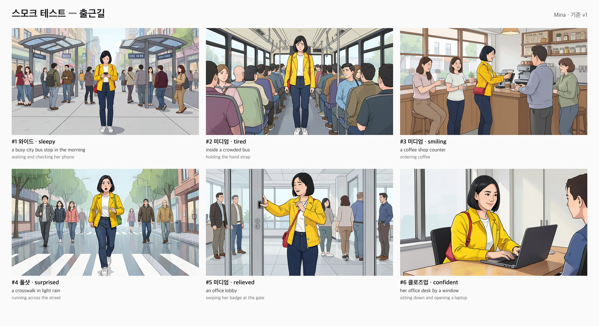
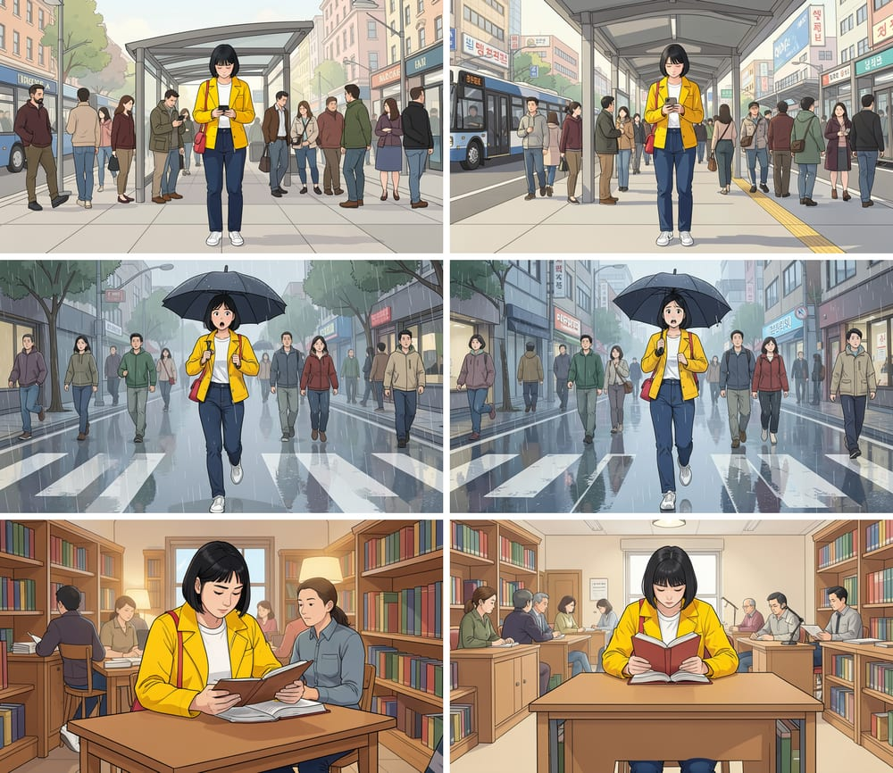

# Continuity Board

**캐릭터 1명으로 6컷을 만들고, 승인한 컷은 그대로 두면서 잘못된 컷만 고치는 오픈소스 스토리보드.**

짧은 광고, 영상, 그림책의 콘티를 만드는 소규모 제작자를 위한 도구입니다. 로컬 [ComfyUI](https://github.com/comfyanonymous/ComfyUI)와 [FLUX.2 [klein] 4B](https://github.com/black-forest-labs/flux2)(Apache 2.0)로 동작합니다. 이 도구가 중점을 두는 것은 캐릭터 생성 자체가 아니라 다음 세 가지입니다.

- **캐릭터 기준을 버전으로 관리합니다.** 기준을 바꿔도 이미 승인한 컷은 남고, 이전 기준으로 만든 컷에는 표시가 붙습니다.
- **수정 범위를 통제합니다.** 수정 결과는 새 후보로만 추가되고, 사람이 승인하기 전에는 아무것도 바뀌지 않습니다. 이전 결과로 언제든 복원할 수 있습니다.
- **생성 과정을 재현할 수 있게 남깁니다.** 참조 이미지, 프롬프트, 시드, 모델 파일명, 실제로 제출한 ComfyUI 그래프를 프로젝트와 함께 내보냅니다.

> **‘고정’은 두 가지 의미로 나뉩니다**
> - **컷 승인은 시스템이 보장합니다.** 승인한 이미지 파일은 다른 컷을 생성하거나 수정해도 바뀌지 않습니다. 파일은 내용 해시를 이름으로 저장하며, 덮어쓰지 않습니다.
> - **캐릭터 특징 유지는 유도입니다.** 참조와 프롬프트로 유도할 뿐 모델 출력이므로 완전히 보장되지는 않습니다.

## 실제 실행 결과

`npm run smoke:comfy`가 Mac Studio M5 Ultra에서 실제 모델로 만든 결과입니다. 기준 이미지 2장([examples/mina](examples/mina/))도 같은 모델이 텍스트만으로 만든 가상 인물입니다. 컷마다 후보를 1개씩만 만들었고, 고르지 않고 그대로 승인했습니다.



**영역 수정.** 왼쪽은 원본, 가운데는 칠한 영역(빨간색), 오른쪽은 `change the red shoulder bag on her left hip to a bright green shoulder bag` 결과입니다. 칠한 영역의 가방만 초록색으로 바뀌었고, 칠하지 않은 왼쪽 빨간 가방은 그대로입니다. 마스크 밖에서 바뀐 픽셀은 0개였습니다. 다른 승인 컷 5개의 파일 해시도 그대로였습니다.


**처리 시간** (1344×768, 컷마다 후보 1개)

| 작업 | M5 Ultra 96GB · `distilled` (bf16) | M5 Ultra · `gguf` (Q8_0) | M5 Ultra · `base` | M4 24GB · `distilled` (`--disable-smart-memory`) |
|---|---|---|---|---|
| 첫 컷 (모델 로딩 포함) | 10~16초 | 13초 | 86초 | 456초 |
| 이후 생성 | 10~11초 | 10.7초 | 83초 | 227~312초 |
| 수정 (참조 3장) | 15초 | 16초 | 129초 | 405초 |
| 영역 수정 | 15초 | 16초 | 129초 | — |

단계별로 나눠 보면, M5 Ultra에서 `distilled` 컷 1장은 준비(텍스트·참조 인코딩) 1.5초, 그리기 8.3초, 마무리 0.2~0.3초입니다. ComfyUI를 새로 띄운 뒤 첫 컷은 모델을 불러오느라 준비가 3.2초로 늘어 전체 12.3초입니다. 앱은 ComfyUI가 로더 노드를 실제로 실행했는지(캐시를 썼는지)로 “모델을 불러온 실행”을 판정하고, 단계별 시간을 후보마다 기록합니다. 이 값은 검토 화면과 `evaluation.csv`에서 볼 수 있습니다.

모든 측정은 ComfyUI 0.39.0(`e8665ca`)으로 했습니다. M4는 측정하는 동안 다른 앱 때문에 스왑을 거의 다 쓰던 상태였습니다. 프리셋 비교에서 관찰한 내용은 다음과 같습니다.

- `gguf`는 M5 Ultra에서 bf16과 속도와 품질이 비슷했습니다. 이 프리셋의 장점은 메모리 사용량입니다.
- `base`는 8배쯤 느렸고, 이번 6컷 표본에서는 더 낫지 않았습니다. 한 컷에 인물이 두 번 나왔고, 비 장면이 사라진 컷도 있었습니다. 그래서 평가할 때 비교용으로만 씁니다.

## 빠른 시작

요구 사항은 Node.js 23.6 이상(TypeScript를 빌드 없이 실행)과 [uv](https://docs.astral.sh/uv/)입니다. nvm을 쓰면 `nvm install && nvm use`로 `.nvmrc`에 지정된 24를 씁니다. 버전이 낮으면 `npm ci`와 `npm start`가 바로 멈추고 이유를 알려 줍니다. 모델을 받으려면 디스크 여유 공간이 약 16GB 필요합니다.

```bash
npm install

# 1) ComfyUI 설치와 모델 다운로드 (한 번만)
./scripts/setup-comfyui.sh                 # 기본 위치: ~/ComfyUI-Installs/ComfyUI
# 이미 쓰는 모델 폴더가 있으면: MODELS_DIR=~/ComfyUI-Shared/models ./scripts/setup-comfyui.sh

# 2) ComfyUI 실행 (메모리 32GB 이하 Mac은 --disable-smart-memory 필수, 아래 참고)
~/ComfyUI-Installs/ComfyUI/.venv/bin/python ~/ComfyUI-Installs/ComfyUI/main.py --listen 127.0.0.1 --port 8188 --disable-smart-memory

# 3) 앱 실행 → http://127.0.0.1:5177
npm start
```

GPU나 모델 없이 화면과 흐름만 확인하려면 다음을 실행합니다.

```bash
npm run start:mock      # 입력과 시드로 결정되는 가짜 이미지를 만듭니다
```

상단의 상태 표시가 `ComfyUI 연결됨`, `MOCK 모드`, `ComfyUI 문제`(모델 누락 등) 중 하나로 실행 백엔드를 알려 줍니다.

### 모델 파일

| 파일 | 폴더 | 비고 |
|---|---|---|
| `flux-2-klein-4b.safetensors` (bf16, 7.8GB) | `models/diffusion_models/` | **macOS 기본값.** Apple Silicon(MPS)은 fp8을 실행하지 못합니다 |
| `flux-2-klein-4b-fp8.safetensors` (3.9GB) | `models/diffusion_models/` | Linux/Windows(CUDA) 기본값. ComfyUI 공식 예제와 같은 파일 |
| `qwen_3_4b.safetensors` | `models/text_encoders/` | 이미지 생성용 **텍스트 인코더**입니다. 대본을 쓰는 LLM이 아닙니다 |
| `flux2-vae.safetensors` | `models/vae/` | |

`setup-comfyui.sh`가 운영체제에 맞는 파일을 받습니다.

**통합 메모리 24GB Mac에서는** bf16 확산 모델(7.8GB)과 Qwen3 텍스트 인코더(7.5GB)가 함께 메모리에 남아 스왑이 가득 차고 샘플링이 멈춥니다. 실제로 M4 24GB에서 확인한 현상입니다. ComfyUI를 `--disable-smart-memory`로 실행하면 단계가 끝날 때마다 모델을 내려 이 문제를 피할 수 있습니다. 대신 컷마다 모델을 다시 불러오므로 시간이 더 걸립니다. 기획서가 가정한 96GB 장비에서는 이 옵션이 필요 없습니다.

## 사용 흐름

1. **캐릭터 등록.** 정면 얼굴(image 1)과 전신(image 2) 참조를 올리고, 이름·머리·의상·소품을 입력합니다. 한국어로 입력해도 됩니다(아래 “입력 언어” 참고).
2. **기준 승인.** 지금의 참조와 특징을 **기준 vN**으로 고정합니다. 이후 생성하는 컷은 모두 이 기준을 씁니다. 잘못 바꿨다면 기준 이력에서 이전 버전을 “불러오기”한 뒤 다시 승인하면 됩니다. 기준이 같은지는 버전 번호가 아니라 내용(참조와 특징)으로 판단하므로, 되돌린 기준으로 만든 컷은 다시 최신으로 표시됩니다.
3. **6컷 작성.** 컷마다 장소, 행동, 표정, 샷 크기, (선택) 조명·분위기를 입력합니다. 필요하면 컷에 배경(image 3)과 소품(image 4) 참조를 추가합니다.
4. **생성.** “미승인 컷 모두 생성”이나 컷별 “생성”을 누릅니다. ComfyUI가 꺼져 있거나 재시작 중이면 작업을 실패로 처리하지 않습니다. 대기 배너를 띄우고 2초부터 30초까지 간격을 늘리며 다시 확인하다가, ComfyUI가 돌아오면 자동으로 이어서 실행합니다. 후보 수는 1~3개입니다. 작업은 GPU 1대 기준으로 하나씩 처리되고, 진행률(모델 로딩 → 그리기 n/4 → 마무리)이 표시됩니다. 대기 중이거나 실행 중인 작업은 취소할 수 있고, 실패하거나 취소한 작업은 재시도할 수 있습니다.
5. **검토와 승인.** 컷을 열어 승인본과 후보를 **나란히** 또는 **겹쳐 밀기**로 비교하고 승인합니다. 검토 창에서는 키보드로 <kbd>←</kbd>/<kbd>→</kbd> 컷 이동, <kbd>1</kbd>–<kbd>9</kbd> 후보 선택, <kbd>A</kbd> 승인을 할 수 있습니다. **확대**(<kbd>Z</kbd>)를 켜면 승인본과 후보의 같은 곳이 함께 확대되어(휠로 2~8배), 와이드 샷에서도 얼굴을 비교할 수 있습니다. 체크리스트(얼굴·헤어·의상·소품·장면)로 평가를 남길 수 있습니다.
6. **수정.** 후보를 골라 “가방 색 수정” 같은 지시를 넣으면, 그 컷이 image 1로 들어가 **새 후보**가 만들어집니다. 마음에 들면 승인하고, 아니면 이전 후보로 복원합니다.
   - **영역 칠하기:** 고칠 곳을 붓으로 칠하면 그 영역만 다시 그립니다. 지우개, 되돌리기(<kbd>Cmd/Ctrl</kbd>+<kbd>Z</kbd>), 실제 붓 크기를 보여 주는 커서가 있습니다. 칠한 곳 밖의 픽셀은 원본과 **바이트 단위로 같게** 유지됩니다.
   - **이전 기준 컷 갱신:** 기준을 v2로 바꾸면, 이전 기준으로 승인한 컷마다 현재 기준에 맞추는 수정 후보를 한 번에 만듭니다. 승인은 사람이 직접 바꿉니다.
7. **내보내기.** “내보내기 ZIP”을 누르면 보드 PNG, 승인 컷, 프로젝트 JSON, 모든 참조와 후보, 컷별 ComfyUI 그래프, 평가표 CSV가 함께 저장됩니다. 이 ZIP은 “가져오기”로 다른 장비에서 그대로 다시 열 수 있습니다.

“무결성 확인”은 프로젝트가 참조하는 모든 이미지의 해시를 다시 계산해, 승인 파일이 바뀌지 않았음을 보여 줍니다.

참조 사진을 여러 번 바꿔 올리면, 아무 데서도 쓰지 않는 파일은 10분이 지난 뒤 자동으로 지웁니다(앱 시작 시, 참조 교체 시, `POST /api/projects/{id}/gc`). 기준 버전, 후보, 마스크, 각 생성에 실제로 쓰인 참조는 지우지 않습니다. 내보내기 ZIP에도 이 파일을 모두 넣으므로, 가져온 프로젝트에서도 “어떤 참조로 만들었는지”가 그대로 남습니다.

### 입력 언어

같은 인물과 장면 3개를 영어(왼쪽)와 한국어(오른쪽)로 입력하고, 같은 시드로 실제 모델에서 비교했습니다. **한국어로 써도 인물 일관성과 장면 지시(우산을 들고 뛰기, 놀란 표정, 책 읽기)를 영어만큼 잘 따랐습니다.** 차이는 배경입니다. 한국어로 쓰면 한국식 간판이 생기고, 그 글자가 깨진 한글로 나옵니다. 영어로 써도 간판 글자는 깨집니다. 프롬프트에 “간판은 단순한 도형으로” 같은 문장을 넣어 봤더니 간판과 깨진 글자가 오히려 늘었습니다. 무언가를 언급하면 모델이 그쪽에 주목하기 때문입니다. 그래서 프롬프트로 막지 않고, 거슬리는 간판은 영역 수정으로 고치도록 안내합니다.



## ComfyUI 워크플로

[`workflows/`](workflows/)에 세 워크플로를 **UI 형식**(ComfyUI에 끌어 놓아 편집)과 **API 형식**(`POST /prompt`)으로 공개합니다. 공식 템플릿 `image_flux2_klein_image_edit_4b_distilled`를 참조 N장으로 일반화한 것입니다.

```text
A. 참조 기반 컷 생성
   얼굴(1) + 전신(2) [+ 배경(3)] [+ 소품(4)]
     → LoadImage → ImageScaleToTotalPixels(1MP) → VAEEncode
     → ReferenceLatent 체인 (긍정 조건과, ConditioningZeroOut으로 만든 부정 조건 양쪽에 연결)
   캐릭터 특징 + 스타일 + 컷 지시 → CLIPTextEncode (Qwen3 4B)
     → CFGGuider(cfg 1) + Flux2Scheduler(4 steps) + euler → SamplerCustomAdvanced
     → VAEDecode → 1344×768 컷

B. 기존 컷 수정
   수정할 컷(1) + 얼굴(2) + 전신(3) + 수정 지시 → 위와 같은 그래프 → 새 후보

C. 영역 지정 수정
   수정할 컷(1) + 얼굴(2) + 전신(3) + 수정 지시 (B와 같은 프롬프트)
     → 원본 latent에 SetLatentNoiseMask(마스크)를 씌워 그 영역만 샘플링
     → 앱 서버가 결과를 원본 위에 합성 (마스크 밖은 원본 바이트 그대로)
```

배경·소품 참조는 0.5MP, 얼굴·전신·수정할 컷은 1MP로 줄여 인코딩합니다. BFL은 참조가 여러 장일 때 1MP를 상한으로 권장합니다. 프롬프트는 BFL의 FLUX.2 가이드를 따라 인물을 먼저 쓰는 서술형으로 만들고, 부정문 대신 원하는 모습을 적습니다(FLUX에는 부정 프롬프트가 없습니다).

- 모든 컷은 **승인된 원본 참조**에서 생성합니다. 직전 컷을 참조로 이어 붙이지 않으므로 변형이 누적되지 않습니다.
- 영역을 칠하지 않은 수정은 이미지 전체를 다시 그리므로 배경이나 얼굴도 바뀔 수 있습니다.
- `npm run workflows`를 실행하면 `workflows/`를 다시 만듭니다.

## 설정

| 환경 변수 | 기본값 | 설명 |
|---|---|---|
| `PORT` / `HOST` | `5177` / `127.0.0.1` | 앱 주소 |
| `COMFY_URL` | `http://127.0.0.1:8188` | ComfyUI 주소 |
| `CB_BACKEND` | `comfyui` | `mock`이면 모델 없이 동작 |
| `CB_DATA` | `./data` | 프로젝트 저장 위치 |
| `CB_PRESET` | `distilled` | `distilled`(기본), `base`(품질 비교용), `gguf`(저메모리용). 아래 표 참고 |
| `CB_DIFFUSION_MODEL` / `CB_TEXT_ENCODER` / `CB_VAE` | 프리셋 값 | 파일명을 직접 지정할 때 |
| `CB_STEPS` / `CB_CFG` | 프리셋 값 | |
| `CB_TIMEOUT_MS` | `900000` | 작업 1건의 제한 시간 |
| `CB_FREE_ON_IDLE` | 꺼짐 | `1`이면 대기열이 빌 때 ComfyUI에 모델 해제(`/free`)를 요청. 메모리가 작은 장비용 |
| `CB_KEEP_COMFY_OUTPUTS` | 꺼짐 | `1`이면 결과를 ComfyUI의 `output/`에도 저장합니다. 기본값은 ComfyUI 임시 폴더(재시작 시 삭제)를 씁니다. 결과는 언제나 프로젝트에 저장됩니다 |
| `CB_ALLOWED_HOSTS` | (없음) | `localhost` 외에 앱에 접속할 호스트 이름 (쉼표로 구분) |

| 프리셋 | 모델 | 설정 | 설치 |
|---|---|---|---|
| `distilled` | FLUX.2 [klein] 4B Distilled (Mac은 bf16, 그 외는 fp8) | 4 steps, cfg 1 | 기본 |
| `base` | FLUX.2 [klein] 4B Base | 20 steps, cfg 5, 빈 프롬프트 부정 조건 (공식 Base 템플릿과 같음) | `WITH_BASE=1 ./scripts/setup-comfyui.sh` |
| `gguf` | Q8_0 GGUF 확산 모델 + Qwen3-4B Q8_0 | 4 steps, cfg 1 (ComfyUI-GGUF 커스텀 노드) | `WITH_GGUF=1 ./scripts/setup-comfyui.sh` |

### 보안

앱에는 로그인이 없습니다. 그래서 사용자가 방문한 다른 웹사이트가 앱을 조작하지 못하도록 다음 세 가지를 막습니다.

- 허용되지 않은 `Host`로 들어온 요청 (DNS 리바인딩 방지)
- 다른 출처(`Origin`)에서 보낸 요청
- CORS 사전 확인(preflight) 없이 보낼 수 있는 형식(`text/plain`, 폼)으로 보낸 쓰기 요청

입력도 검사합니다.

- **업로드한 참조 이미지:** EXIF 회전을 반영하고 GPS 위치·카메라 정보 같은 메타데이터를 모두 지운 뒤 PNG로 저장합니다. 최대 64MP, 긴 변 4096px입니다.
- **가져오기:** 압축을 풀기 전에 ZIP 목록의 크기를 확인해 zip bomb을 막습니다(파일당 256MB, 합계 3GB). `project.json`과 `assets/`만 꺼내고, 프로젝트 구조와 참조하는 모든 파일의 해시를 확인한 뒤에야 프로젝트를 만듭니다.

기본 주소는 `127.0.0.1`입니다. 다른 기기에서 접속하게 하려면 `HOST`와 `CB_ALLOWED_HOSTS`를 지정합니다. 이 경우 같은 네트워크의 누구나 접근할 수 있다는 점에 유의하세요.

## 구조

```text
server/
  index.ts          서버 진입점 (백엔드 선택, 재시작 복구)
  app.ts            HTTP API와 정적 파일
  model.ts          프로젝트 데이터 모델 (기준 버전, 컷, 후보, 작업, 승인 이력)
  store.ts          파일 저장소: project.json 원자적 쓰기, 해시 이름 에셋, 무결성 검증
  jobs.ts           단일 GPU 작업 큐: 상태 저장, 진행률, 취소, 재시도, 재시작 후 이어받기
  prompt.ts         참조 역할(image 1~4)과 프롬프트 구성
  workflow.ts       ComfyUI 그래프 생성 (API 형식 → UI 형식 변환 포함)
  export.ts         보드 PNG, ZIP 내보내기·가져오기, 평가표 CSV
  inpaint.ts        영역 수정: 마스크 정규화, 원본 보존 합성
  backends/         comfy.ts (ComfyUI API + 웹소켓 진행률·취소·이어받기), mock.ts (모델 없이 동작)
web/                빌드 과정이 없는 UI (index.html, app.js, style.css)
workflows/          공개 워크플로 (UI·API 형식)
scripts/            setup-comfyui.sh, smoke-comfy.ts (실제 모델 E2E), export-workflows.ts
test/               흐름·보안·기능 테스트, 가짜 ComfyUI 서버로 하는 백엔드 테스트
docs/               평가 가이드, 2분 데모 대본
```

ComfyUI와의 연결에는 ComfyUI 자체 API(`/upload/image`, `/prompt`, `/ws`, `/history`, `/view`, `/api/jobs/{id}`, `/api/jobs/{id}/cancel`)를 씁니다. 화면은 서버가 보내는 이벤트 스트림(`/api/projects/{id}/events`)으로 갱신됩니다. 프로젝트가 바뀔 때만 보내고 진행률은 250ms마다 묶어 보내므로, 다른 탭에서 시작한 작업도 바로 보입니다. 화면용 응답에는 ComfyUI 그래프를 빼서 크기가 1/3로 줄었습니다(후보 24개 기준 129KB → 43KB). 그래프는 후보마다 따로 받습니다. 작업 ID는 앱이 먼저 만들어 저장한 뒤 제출합니다. 그래서 앱이 재시작돼도 ComfyUI가 만들던 결과를 버리지 않고 이어받습니다. 웹소켓이 끊기면 `/history` 폴링으로 결과를 받습니다. 기획 단계에서 검토한 Comfy TypeScript SDK는 베타이고 로컬 실행에 API v2 프록시가 별도로 필요해, MVP에서는 의존성 없는 네이티브 API를 택했습니다. 실행 백엔드가 `Backend` 인터페이스 하나로 분리되어 있으므로, 나중에 SDK나 Comfy Cloud 백엔드를 추가할 수 있습니다.

## 테스트

```bash
npm test               # 42개: mock 백엔드 흐름, 보안, 기능, 가짜 ComfyUI 서버로 하는 백엔드 테스트
npm run typecheck
npm run report         # 모든 프로젝트를 모아 평가 보고서 (기획서 목표 대비) 생성
npm run smoke:comfy    # 실제 ComfyUI: 기준 이미지 → 6컷 → 수정 → 영역 수정 → 무결성 → 내보내기
```

`npm test`가 검증하는 항목은 다음과 같습니다.

- 6컷을 생성하고 승인한 뒤, 한 컷을 수정하거나 다른 컷을 다시 생성해도 **다른 승인 컷의 파일 해시가 그대로**입니다.
- 승인하지 않은 후보가 승인 결과를 덮어쓰는 경우가 **0건**입니다.
- 기준을 바꾸면 기존 승인 컷은 유지되고 “이전 기준”으로 표시됩니다.
- 실패한 작업을 기록하고 재시도할 수 있습니다.
- 앱이 재시작되면 실행 중이던 작업과 대기 중이던 작업이 이어서 실행되고, 승인 결과는 보존됩니다.
- 내보낸 ZIP에 필요한 구성 요소가 모두 있고, 다시 가져왔을 때 해시가 일치합니다. 40MB가 넘는 파일도 가져올 수 있습니다.
- **영역 수정:** 마스크 밖 픽셀은 바이트 단위로 원본과 같습니다.
- **취소:** 실행 중이거나 대기 중인 작업을 취소하면 후보 없이 “취소됨”으로 남습니다. 진행률은 실행 중에만 노출됩니다.
- **이전 기준 컷 갱신:** 이전 기준으로 승인한 컷에만 수정 작업을 만들고, 이미 갱신한 컷은 다시 만들지 않습니다.
- **보안:** 다른 출처, DNS 리바인딩 `Host`, `text/plain` 쓰기 요청을 거부합니다.
- **프롬프트:** 패널 번호와 부정문이 없고, 인물을 먼저 쓰며, 스타일로 끝납니다.
- **ComfyUI 백엔드:** 우리가 정한 prompt_id로 제출, 웹소켓 진행률, 검증·실행 오류 전달, 취소, 재시작 후 이어받기, 웹소켓 없이 폴링으로 받기, 없는 모델 감지를 확인합니다.

## 범위

| 포함 (MVP) | 후속 |
|---|---|
| 캐릭터 1명, 참조 2장, 기준 버전 | 여러 캐릭터, 자동 캐릭터 시트 |
| 6컷, 16:9, 장소·행동·표정·샷 | 자유로운 페이지·비율, 대본 자동 분할 |
| 컷별 작업 상태, 실패 재시도 | 여러 GPU, 병렬 처리 |
| 후보 비교, 승인, 복원, 체크리스트 | 자동 일관성 점수, 오류 탐지 |
| 참조 기반 전체 재생성 수정, 영역 지정 수정 | 포즈·깊이 제어 |
| 단일 사용자 로컬 저장 | 로그인, 실시간 공동 편집 |
| 보드 PNG, ZIP(이미지·프로젝트·워크플로) | 영상, 음성, 애니매틱 |

## 라이선스

이 저장소의 코드는 Apache-2.0입니다. FLUX.2 [klein] **4B**(Distilled·Base)도 Apache-2.0이지만, 9B와 dev 계열은 비상업 라이선스이므로 모델을 바꿀 때 라이선스를 확인하세요.
